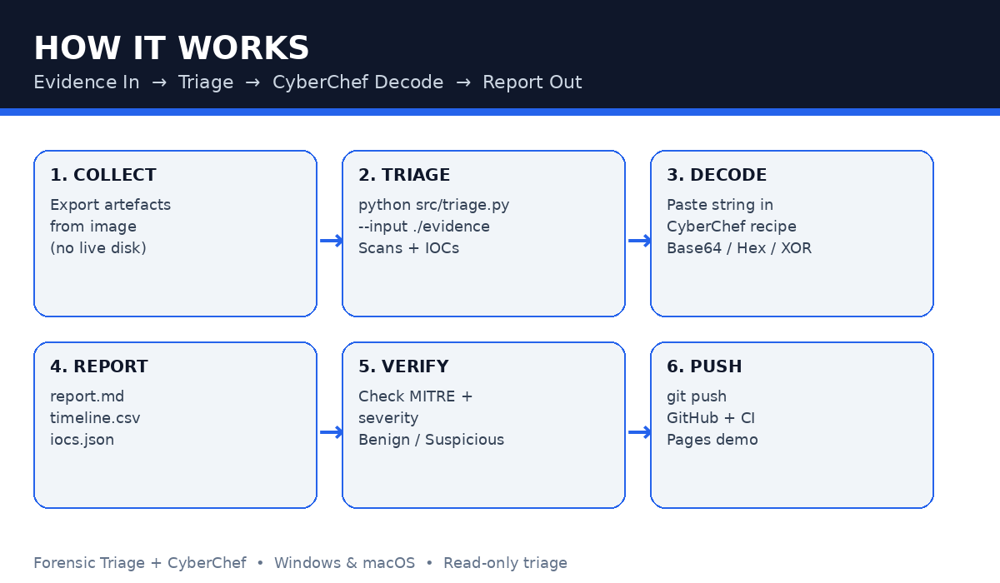
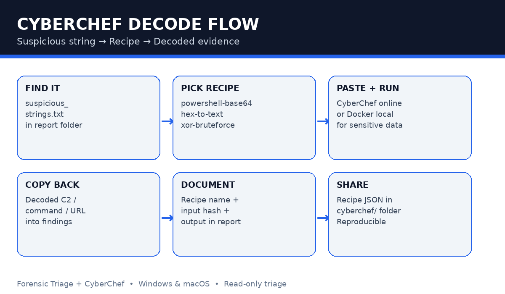

# HOW TO USE — Full Guide



## Step 0: What You Need
- Python 3.11+ (`python --version`)
- Git (`git --version`)
- Optional: Docker (for local CyberChef)

## Step 1: Clone / Download
```bash
git clone https://github.com/<you>/forensic-triage-cyberchef.git
cd forensic-triage-cyberchef
```

## Step 2: Setup
**Linux / macOS:**
```bash
./setup.sh
# does: python -m venv .venv && source .venv/bin/activate && pip install -r requirements.txt
```
**Windows (CMD):**
```bat
setup.bat
```
**Windows (PowerShell):**
```powershell
python -m venv .venv
.\.venv\Scripts\Activate.ps1
pip install -r requirements.txt
```

## Step 3: Run Demo
```bash
python tests/generate_fixtures.py --out ./samples
python src/triage.py --input ./samples/windows-triage --os windows --out ./reports/demo-windows
python src/triage.py --input ./samples/macos-triage --os macos --out ./reports/demo-macos
ls reports/demo-windows/
cat reports/demo-windows/report.md
```

## Step 4: Triage Real Evidence
1. Export artefacts from image to `./evidence/` — see README layout.
2. Run: `python src/triage.py --input ./evidence --out ./reports/case-001`
3. Open `reports/case-001/report.md`

## Step 5: Decode in CyberChef

1. Open `reports/case-001/suspicious_strings.txt`
2. Copy one string → Open its CyberChef link from `report.md`
3. Or manually: https://gchq.github.io/CyberChef/ → Load `cyberchef/<recipe>.json` → Paste → Run
4. Copy decoded output into your report.
5. For sensitive data: `docker run -p 8080:8000 ghcr.io/gchq/cyberchef` → open http://localhost:8080

## Step 6: Document Findings
Use this template for EACH finding:
```
- Artefact: Prefetch / LaunchAgent / .evtx ...
- Path: full path in image
- Timestamp: from timeline.csv
- Raw: <truncated raw value>
- CyberChef Recipe: powershell-base64.json
- Decoded: <decoded output>
- MITRE: T1059.001
- Severity: High / Medium / Low
- Verdict: Benign / Suspicious / Malicious
```

## Troubleshooting
| Problem | Fix |
|---|---|
| `python: command not found` | Use `python3` on macOS/Linux |
| `No module named ...` | Re-run `pip install -r requirements.txt` inside `.venv` |
| `No findings` | Check `--input` path, ensure files are exported (not .E01) |
| CyberChef link broken | Use online CyberChef + manually load recipe JSON |
| Images not showing on GitHub | Ensure `assets/` is committed, paths are `assets/01-workflow.png` |

## Commands Cheat Sheet
```bash
python src/triage.py --help
python src/triage.py --input ./samples/windows-triage --os windows --out ./reports/demo-windows
python src/triage.py --input ./samples/macos-triage --os macos --out ./reports/demo-macos
python src/triage.py --input ./evidence --out ./reports/case-001
```
